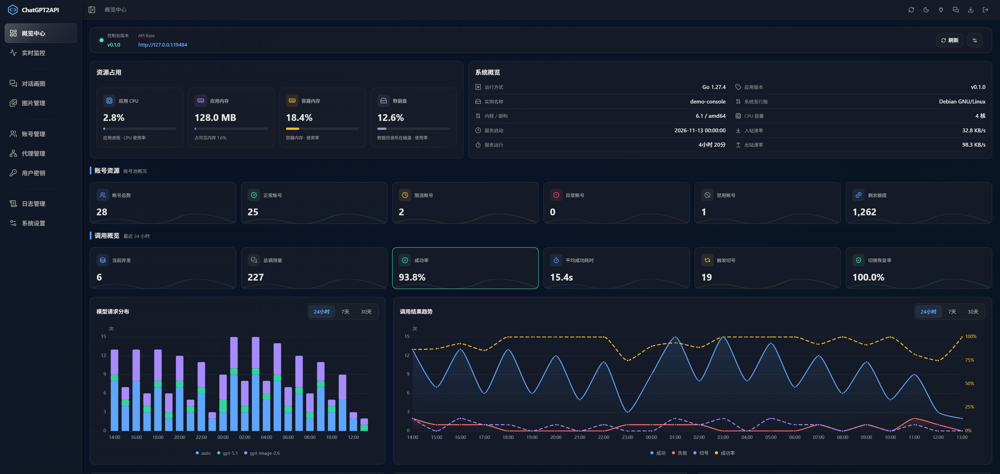
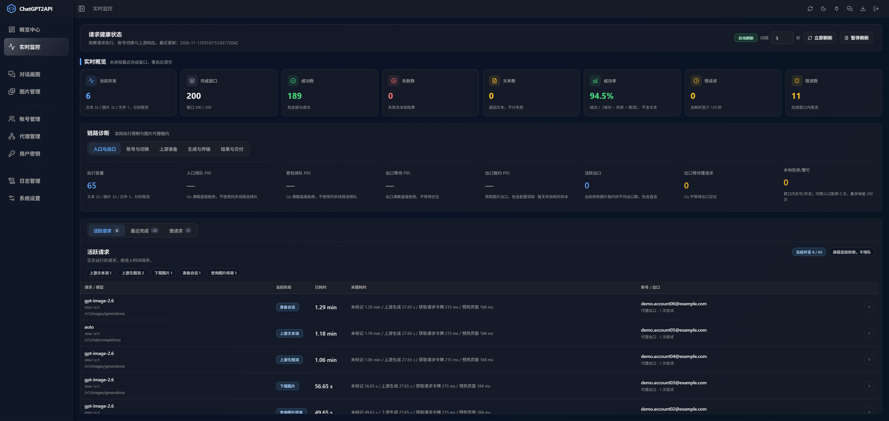
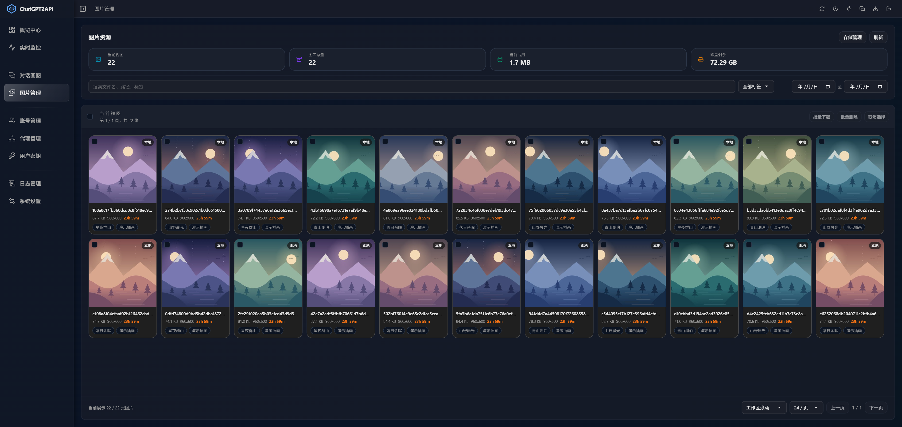
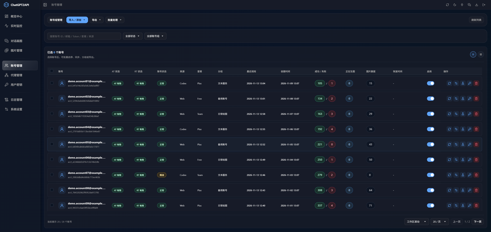
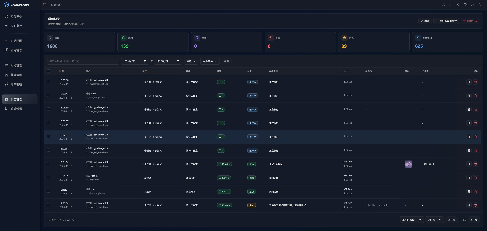

# go-chatgpt2api

Status: current

Go 服务内嵌 Vue 3 控制台，一个可执行文件同时提供网页与 API，支持文本对话、图片生成与编辑、账号、代理、用户密钥、图库、日志和实时监控。使用 Gin、PostgreSQL，图片放大使用纯 Go `imaging.Lanczos`。

## 控制台预览

**概览中心**：查看调用趋势、成功率、模型用量与运行状态。



**实时监控**：查看活动请求、执行阶段、关键耗时和上游响应。



**图片管理**：预览图片，按标签与时间筛选，管理下载和存储。



**账号管理**：按来源、套餐与分组管理账号，查看额度和调用结果。



**日志管理**：分别展示请求、执行、密钥、结果、耗时和图片分辨率。



## 下载运行

从 [GitHub Releases](https://github.com/Drunkard-baifeng/go-chatgpt2api/releases) 下载对应系统的压缩包，解压后将 `.env.example` 复制为 `.env`，填写管理员密钥和已独立部署的 PostgreSQL 信息：

```dotenv
ADMIN_KEY='填写随机管理员密钥'
DB_HOST=127.0.0.1
DB_PORT=5432
DB_NAME=chatgpt2api_go
DB_USER=chatgpt2api
DB_PASSWORD='填写数据库密码'
DB_SSLMODE=disable
```

在该目录直接启动，Windows 使用 `chatgpt2api.exe`，Linux 使用 `./chatgpt2api`。浏览器打开 `http://127.0.0.1:8100`，使用管理员密钥登录；网页和 API 共用此端口。

启动时自动检测并初始化数据库。数据库角色须事先存在；已有数据库直接复用，自动创建不存在的数据库需要角色具有 `CREATEDB` 权限。无需手动执行初始化命令。

程序默认读取当前工作目录的 `.env`，也可用 `--env-file /路径/.env` 指定文件；同名进程环境变量优先。相对数据路径以读取的 `.env` 所在目录为基准；仅注入环境变量时以工作目录为基准。密码含 `$`、`#` 或空格时使用单引号，保留原数据目录。

旧 YAML 部署请先把管理员密钥、数据库连接及自定义目录迁移到 `.env`，手动替换程序并移除启动命令中的 `--config`。新版不再读取 YAML，也不会自动删除旧文件。旧版在线更新器沿用旧启动参数，跨此次配置变更须手动升级一次。

## Docker / 1Panel

PostgreSQL 请自行部署；[编排文件](docker-compose.yml) 只启动应用，不包含数据库。Linux / 1Panel 使用宿主机网络，`DB_HOST=127.0.0.1` 和 `DB_PORT` 填独立数据库映射到宿主机的端口，无需配置容器间网络。不要使用应用自己的数据卷保存数据库文件。

在 1Panel 的“容器 → 编排”中创建编排，选择“编辑”方式（直接填写编排内容），粘贴[编排文件](docker-compose.yml)。在页面下方的“环境变量”框中填写以下内容，再保存并启动，**无需手动创建 `.env` 文件**：

```dotenv
ADMIN_KEY='填写随机管理员密钥'
DB_HOST=127.0.0.1
DB_PORT=5432
DB_NAME=chatgpt2api_go
DB_USER=chatgpt2api
DB_PASSWORD='填写数据库密码'
DB_SSLMODE=disable
SERVER_HOST=127.0.0.1
SERVER_PORT=8100
```

`DB_PORT` 填数据库映射到宿主机的实际端口；更多可选变量见[配置模板](.env.example)。编排通过 `environment` 将这些变量传入容器。若保存时报 `env file ... .env not found`，说明仍在使用含 `env_file: .env` 的旧编排，替换为当前编排文件后重新保存即可。

在服务器命令行部署时，将 `.env` 与编排文件放在同一目录，再执行：

```sh
docker compose up -d
```

使用发布镜像 `ghcr.io/drunkard-baifeng/go-chatgpt2api:latest`，也可改为指定版本标签。镜像包含完整控制台，支持 Linux amd64/arm64，业务数据保存到 `/app/data` 命名卷，无需挂载配置文件。

默认只监听回环地址，1Panel 反向代理至 `http://127.0.0.1:8100` 即可。需要从外部直接访问端口时，设置 `SERVER_HOST=0.0.0.0`；宿主机网络下无需再写 `ports`。若数据库或反向代理在独立容器中，数据库须提供宿主机可连接的端口，反向代理目标须是其可达的宿主机地址。

更新镜像执行 `docker compose pull api` 和 `docker compose up -d api`。在 1Panel 修改环境变量后保存并重建容器；命令行修改 `.env` 后也需执行 `up -d` 重建容器使变量生效。不要删除业务数据卷。

## Nginx 反向代理

普通部署无需填写图片域名。程序自动按当前访问地址生成图片链接，可信代理设置的协议和域名会用于 HTTPS 链接。系统设置中的“图片访问地址”留空即可，只有自定义图片域名时才填写。

将以下配置合入已有 HTTPS 站点，保留原有域名、证书及 HTTP 跳转配置：

```nginx
# 放在已有 HTTPS 站点的 server 块内；保留站点原有监听、证书和域名。
# 允许包含参考图的编辑请求；后端仍会执行自己的大小校验。
client_max_body_size 140m;
# 客户端上传请求体时，相邻两次读取最多等待 30 秒，并非整个上传限时。
client_body_timeout 30s;

location / {
    # 网页和 API 都转发到同一个应用端口。
    proxy_pass http://127.0.0.1:8100;
    proxy_http_version 1.1;

    # 覆盖来源头，让应用按实际访问域名和 HTTPS 协议生成图片链接。
    proxy_set_header Host $http_host;
    proxy_set_header X-Forwarded-Host $http_host;
    proxy_set_header X-Forwarded-Proto $scheme;
    # 单层反代直接写入客户端地址，避免透传客户端伪造的来源链。
    proxy_set_header X-Real-IP $remote_addr;
    proxy_set_header X-Forwarded-For $remote_addr;
    # 不向后端传递客户端的 Connection 逐跳头。
    proxy_set_header Connection "";

    # 及时传递 SSE 等流式响应，不等待响应缓冲区填满。
    proxy_buffering off;
    # 上传的请求体边接收边转发，避免先完整缓存在 Nginx。
    proxy_request_buffering off;
    # API 与控制台响应不使用代理缓存。
    proxy_cache off;
    # 禁止自动切换上游或重试，避免生成请求重复执行。
    proxy_next_upstream off;

    # 与本机后端建立连接最多等待 10 秒。
    proxy_connect_timeout 10s;
    # 向后端发送请求时，相邻两次写入最多等待 660 秒。
    proxy_send_timeout 660s;
    # 等待后端响应时，相邻两次读取最多等待 660 秒，并非请求总时限。
    proxy_read_timeout 660s;
    # 向客户端发送响应时，相邻两次写入最多等待 60 秒。
    send_timeout 60s;
}
```

执行 `nginx -t` 验证后再重载。以上关闭缓冲以支持流式响应，并禁止代理自动重放请求。`proxy_read_timeout`、`proxy_send_timeout` 是两次读写之间的空闲超时，660 秒不会延长后端自身的生成预算；CDN 和调用客户端也需提供足够等待时间。

默认信任本机与私网代理，可通过 `SERVER_TRUSTED_PROXIES` 指定代理 IP/CIDR（逗号分隔）；公网代理需显式加入，留空列表则忽略转发头。反向代理必须覆盖上述来源头，不能透传客户端提供的伪造值。公网多层代理应在入口和内层分别配置可信链。

## 在线更新

直接运行的正式 Windows/Linux amd64、arm64 程序，可在控制台右上角“查看版本更新”检查并安装更高稳定版。程序校验下载内容后替换、重启，启动失败尝试恢复旧程序，保留 `.env` 和业务数据。程序目录须可写；Docker、开发构建及托管服务使用对应部署工具升级。详情见[后端说明](go_backend/README.md#在线更新)。

## 构建与启动

Go 最低 **1.27.4**，Node.js 使用 **22.23.5 LTS**，仅用于构建，实际固定版本见 [go.mod](go_backend/go.mod) 和 [版本文件](new_frontend/.node-version)。补丁来源见 [Go 官方记录](https://go.dev/doc/devel/release#go1.27.4) 和 [Node.js 官方说明](https://nodejs.org/en/blog/release/v22.23.5)。

在仓库根目录执行：

```powershell
npm --prefix new_frontend ci --registry=https://registry.npmjs.org
node scripts/build.mjs
if (!(Test-Path .env)) { Copy-Item .env.example .env }
# 填写 .env 后启动
.\bin\chatgpt2api-windows-amd64.exe
```

已有 `.env` 时保留原文件。构建产物在 `bin/`，已经内嵌前端；运行时不需要 Node.js 或静态站点。交叉编译先设置 `GOOS`、`GOARCH` 后重跑构建。也可通过 `docker build -f go_backend/Dockerfile -t chatgpt2api .` 从源码构建镜像。

本地从源码启动后端时，在上述目录执行以下命令；`.env` 放在 Go 项目根目录，数据库已独立启动，网页与 API 地址均为 `http://127.0.0.1:8100`：

```powershell
cd go_backend
go run ./cmd/chatgpt2api --env-file ../.env
```

首次使用 `go run` 前，先按上面的命令完成构建，或执行 `node scripts/build.mjs --prepare` 准备内嵌资源。开发前端时，在另一个终端回到 Go 项目根目录执行 `npm --prefix new_frontend run dev`；前端默认在 5176，代理至 8100。

## 来源与许可

基于 yukkcat/chatgpt2api 的业务行为重构，保留来源及第三方许可。源码许可见 [LICENSE](LICENSE)，版权与上游声明见 [NOTICE](NOTICE)，控制台参考来源见 [第三方声明](new_frontend/THIRD_PARTY_NOTICES.md)。
